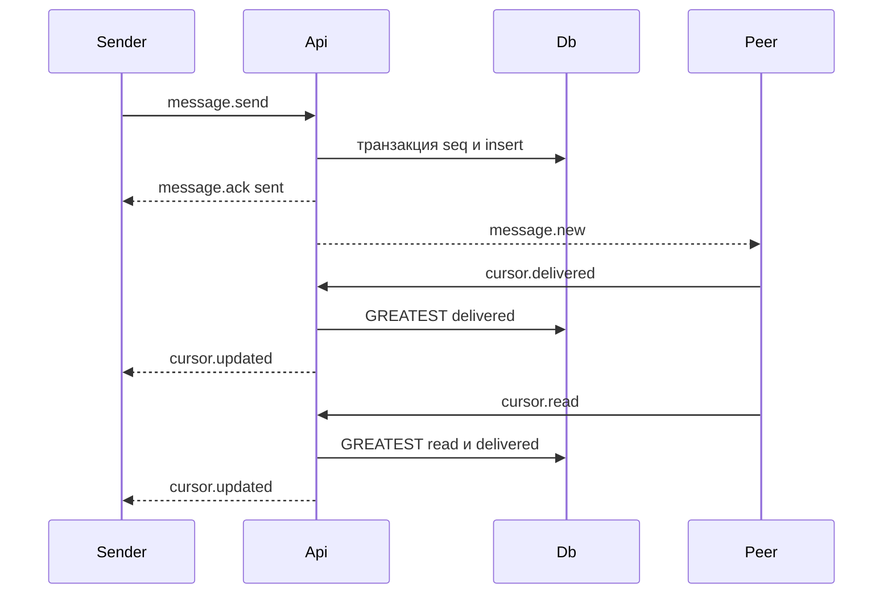

# Dyad

Веб-мессенджер для двоих. Телефон — основной экран. Регистрация, список диалогов, живая переписка, статусы доставки и базовая модерация.

## Границы

В работе есть:

- регистрация и вход по логину и паролю;
- поиск собеседника по точному логину;
- один диалог на пару;
- текст 1–2000 символов;
- WebSocket для живых событий и HTTP для снимка состояния;
- статусы «отправлено», «доставлено», «прочитано»;
- блокировка и жалоба без админки;
- русский интерфейс.

В работе нет: файлов, групп, каналов, ролей, «печатает…», правки и удаления сообщений, почты, подтверждения email, push-уведомлений, Redis, gRPC, long polling, нескольких экземпляров API, скрытия сообщений модератором, удаления аккаунта.

Один процесс API — предел продукта. Сокеты живут в его памяти. Второй экземпляр собеседника на другом процессе не увидит.

## Стек

Монорепозиторий pnpm:

```text
apps/api        Fastify, ws, Drizzle, PostgreSQL
apps/web        Vite, React, TypeScript
packages/contracts   схемы Zod, общие для клиента и сервера
docker-compose.yml
```

Пароль — bcrypt, cost 12. Валидация — Zod. Тесты API — Vitest. Один сквозной сценарий — Playwright.

Браузер видит один origin. В разработке Vite на порту 5173 проксирует `/api` и `/ws` на API (`0.0.0.0:3000`). В Docker Compose Fastify слушает `0.0.0.0:$PORT` (по умолчанию 3000), отдаёт собранный фронтенд и те же `/api` и `/ws`. Телефон в одной сети открывает один адрес.

JSON в camelCase. Колонки в snake_case. Время в JSON — ISO-8601. Ошибки — машинный код на английском, тексты экранов — на русском.

## Поток сообщения



Источник правды — PostgreSQL. Сокет не хранит журнал. После обрыва клиент открывает сокет снова и забирает список и открытую историю по HTTP.

Отправка с HTTP `POST /api/dialogs/:id/messages` и кадр `message.send` вызывают одну функцию.

## Данные

Третья нормальная форма. Имя, текст и причина зависят от ключа своей строки. Статус доставки в сообщение не копируется: он считается из курсора собеседника. Превью списка тоже не хранится, его даёт последнее сообщение.

Удаления строк пользователем нет. Внешние ключи — `ON DELETE RESTRICT`.

### users

| Колонка | Ограничение |
| --- | --- |
| id | uuid, первичный ключ |
| username | уникальный, нижний регистр, 3–24 символа `[a-z0-9_]` |
| password_hash | not null |
| created_at | timestamptz, not null |

### sessions

| Колонка | Ограничение |
| --- | --- |
| id | uuid, первичный ключ |
| user_id | fk → users |
| token_hash | уникальный SHA-256 токена |
| expires_at | timestamptz |
| created_at | timestamptz |

В cookie лежит сам токен, 32 случайных байта в base64url. Имя cookie — `dyad_session`. Флаги: httpOnly, SameSite=Lax, Path=/, Max-Age 30 дней. `Secure` включается при `NODE_ENV=production`. Срок сессии фиксированный, от момента входа, без продления. Выход удаляет строку.

### dialogs

Одна строка на неупорядоченную пару. `user_low < user_high` (сравнение uuid) и уникальность `(user_low, user_high)`. `last_seq` bigint, с нуля. `created_at` timestamptz.

Номер следующего сообщения: в той же транзакции, что и вставка,

```sql
UPDATE dialogs
SET last_seq = last_seq + 1
WHERE id = $1
RETURNING last_seq
```

Первое сообщение получает `seq = 1`.

### messages

| Колонка | Ограничение |
| --- | --- |
| id | uuid, первичный ключ |
| dialog_id | fk → dialogs |
| sender_id | fk → users, участник этого диалога |
| seq | bigint, уникальность `(dialog_id, seq)` |
| body | text, длина 1–2000 после обрезки краёв |
| client_msg_id | uuid, уникальность `(dialog_id, sender_id, client_msg_id)` |
| created_at | timestamptz |

Индекс `(dialog_id, seq DESC)` для истории.

Повтор с тем же `client_msg_id` и тем же текстом возвращает существующую строку. Тот же ключ и другой текст — конфликт, новая строка не пишется.

Если уникальность `seq` столкнулась, транзакция повторяется один раз.

### dialog_cursors

Первичный ключ `(dialog_id, user_id)`. Две строки создаются в транзакции вместе с диалогом.

| Колонка | Смысл |
| --- | --- |
| last_delivered_seq | до какого `seq` клиент этого пользователя получил сообщения, с нуля |
| last_read_seq | до какого `seq` он их прочитал, с нуля |

Проверка: `last_read_seq <= last_delivered_seq`. Оба курсора только растут, в SQL это `GREATEST`. Сдвиг прочтения поднимает доставку до того же номера, если она меньше.

Статус своего сообщения:

- `sent` — строка есть;
- `delivered` — у собеседника `last_delivered_seq >= seq`;
- `read` — у собеседника `last_read_seq >= seq`.

Сначала проверяется прочтение, потом доставка. Непрочитанные у меня — сообщения собеседника с `seq` больше моего `last_read_seq`.

Загрузка последней страницы истории (запрос без `beforeSeq`) поднимает доставку вызывающего до максимального `seq` в ответе. Пустой диалог курсор не двигает. Прочтение этот запрос не двигает. Страница старше (`beforeSeq` задан) курсоры не двигает.

### blocks

Первичный ключ `(blocker_id, blocked_id)`, проверка `blocker_id <> blocked_id`, `created_at`.

Запись в любую сторону замораживает новые сообщения. История остаётся. Список блокировок показывает только тех, кого заблокировал я. Ответ API не содержит формулировки «вы заблокированы».

### reports

| Колонка | Ограничение |
| --- | --- |
| id | uuid, первичный ключ |
| reporter_id | fk → users |
| message_id | fk → messages |
| reason | `spam`, `abuse` или `other` |
| created_at | timestamptz |

Уникальность `(reporter_id, message_id)`. Жалобу подаёт участник диалога и только на чужое сообщение. Текст сообщения из-за жалобы не скрывается.

Индекс `(reporter_id, created_at DESC)` для списка своих жалоб.

## HTTP

Префикс `/api`. Нет сессии — 401 `unauthorized`, кроме регистрации и входа. Чужой диалог и неизвестный id отвечают 404 `not_found`, чтобы по id нельзя было узнать о чужой переписке.

| Метод | Путь | Результат |
| --- | --- | --- |
| POST | `/api/auth/register` | `{ username, password }` → 201 `{ id, username }` и cookie. 409 `username_taken` |
| POST | `/api/auth/login` | та же форма → 200 и cookie. 401 `invalid_credentials` и для неизвестного логина, и для неверного пароля |
| POST | `/api/auth/logout` | 204, строка сессии удалена, cookie сброшена |
| GET | `/api/auth/me` | 200 `{ id, username }` |
| GET | `/api/users/lookup?username=` | 200 `{ id, username }`. 404, если логина нет. 400 `validation_error`, если это я |
| POST | `/api/dialogs` | `{ username }`. Новый диалог — 201. Уже был — 200. Тело: `{ id, peer: { id, username }, created, blocked }`. Неизвестный логин — 404 `not_found`. Свой логин — 400 `validation_error`. Блок есть, диалога нет — 403 `forbidden`, строка не создаётся. Блок есть и диалог есть — 200, писать всё равно нельзя |
| GET | `/api/dialogs` | список текущих диалогов |
| GET | `/api/dialogs/:id/messages?beforeSeq&limit` | страница истории |
| POST | `/api/dialogs/:id/messages` | `{ body, clientMsgId }` |
| POST | `/api/dialogs/:id/delivered` | `{ seq }` → 204 |
| POST | `/api/dialogs/:id/read` | `{ seq }` → 204 |
| POST | `/api/blocks` | `{ username }` → 201, повтор → 204 |
| DELETE | `/api/blocks/:username` | 204 и если блока не было |
| GET | `/api/blocks` | кого я заблокировал |
| POST | `/api/reports` | `{ messageId, reason }` → 201. Повтор → 409 `already_reported`. Своё сообщение → 403 `forbidden` |
| GET | `/api/reports` | только свои жалобы |

Элемент списка диалогов: `{ id, peer: { id, username, online }, lastMessage, unreadCount, blocked }`. `lastMessage` — `{ id, seq, senderId, body, createdAt, status }` или `null`. `status` заполнен, только если последнее сообщение моё, иначе `null`. Порядок: время последнего сообщения по убыванию, диалоги без сообщений — по `created_at` и ниже тех, где переписка уже есть. `online` равен false, если между нами есть блок в любую сторону.

`limit` по умолчанию 50, максимум 100, минимум 1. Ответ: `{ messages, nextBeforeSeq }`. Страница собирается как `seq < beforeSeq` (или хвост диалога, если `beforeSeq` нет), не больше `limit` строк, в ответе по возрастанию `seq`. Если строк меньше, чем `limit`, `nextBeforeSeq` равен `null`. Иначе `nextBeforeSeq` — наименьший `seq` страницы, его и передают следующим `beforeSeq`.

Успешная новая отправка — 201 и сообщение со `status: "sent"`. Повтор того же ключа и текста — 200 и прежнее сообщение, его `status` считается на момент ответа. Сообщение в ответе: `{ id, seq, senderId, body, createdAt, status }`. Любой сдвиг курсора, включая подъём доставки при загрузке последней страницы, рассылает `cursor.updated`.

`seq` меньше 0 или больше `last_seq` — 400 `validation_error`. Курсор при этом не меняется.

Жалоба в списке: `{ id, messageId, dialogId, peerUsername, body, reason, createdAt }`.

Пароль — от 8 символов и не длиннее 72 байт UTF-8. Более длинный не обрезается молча, а отклоняется: bcrypt всё равно не смотрит дальше 72 байт. Логин на входе приводится к нижнему регистру. Пустой текст после обрезки краёв — 400.

Тело ошибки: `{ error: код }`. Для `validation_error` добавляется `fields` — карта поля и короткого кода (`too_short`, `too_long`, `invalid`, `required`). Стека и имён таблиц в ответе нет. Сбой базы и необработанное исключение — 500 `internal`, подробность пишется в лог сервера.

## WebSocket

Путь `/ws`. Сессия берётся из cookie на рукопожатии. Без сессии сокет закрывается кодом `4401` и до кадров не доходит.

Клиент шлёт:

- `message.send` — `{ dialogId, body, clientMsgId }`;
- `cursor.delivered` — `{ dialogId, seq }`;
- `cursor.read` — `{ dialogId, seq }`;
- `ping` каждые 25 секунд.

Сервер шлёт:

- `ready` — сокет принят, без снимка диалогов;
- `message.ack` — всем сокетам отправителя;
- `message.new` — всем сокетам собеседника;
- `cursor.updated` — `{ dialogId, userId, lastDeliveredSeq, lastReadSeq }` всем сокетам обоих участников;
- `presence` — `{ userId, online }` второму участнику диалога, только если блока нет;
- `error` — `{ code, clientMsgId? }`, соединение остаётся;
- `pong`.

Присутствие считается по числу сокетов. Событие уходит на переходах 0→1 и 1→0. Нет ни одного кадра 90 секунд — сервер закрывает сокет и пересчитывает присутствие. Клиентский `ping` не даёт живой вкладке попасть под это правило.

Пока получатель в сети, его клиент после `message.new` шлёт `cursor.delivered` с `seq` этого сообщения. Открытый диалог шлёт `cursor.read` до последнего видимого `seq`.

Обрыв: пауза от 1 секунды, каждая следующая вдвое дольше, потолок 30 секунд. Удачное соединение сбрасывает счётчик. После `ready` клиент заново запрашивает `GET /api/dialogs` и, если диалог открыт, его последнюю страницу истории.

Журнала кадров в памяти нет.

Сокеты процесса: `Map<userId, Set<WebSocket>>`.

## Экраны

Интерфейс на русском. Точка перелома — 900px.

Ниже 900px виден один экран. `/dialogs` — список. `/dialogs/:id` — переписка, «назад» ведёт на список.

От 900px список слева, переписка справа. `/dialogs/:id` выделяет строку. `/dialogs` показывает справа «Выберите диалог».

`/login` и `/register` — форма по центру: логин, пароль, ссылка на соседний экран. После входа — `/dialogs`. В меню списка: блокировки, жалобы, выход. 401 на любом запросе возвращает на `/login`.

Под шапкой списка поле «логин собеседника». Точный логин открывает диалог. Пустой список: то же поле и фраза «Диалогов пока нет». В строке: логин, точка «в сети», превью одной строкой, время, счётчик непрочитанных. Своё последнее сообщение показывает галочки. Число больше 99 на бейдже рисуется как «99+», в данных остаётся точное.

В шапке диалога: логин, «в сети» или «не в сети», «Заблокировать» или «Разблокировать». Чужое сообщение открывает «Пожаловаться» с причинами «спам», «оскорбление», «другое» (`spam`, `abuse`, `other`). У своего сообщения этого действия нет.

Поле ввода и кнопка «Отправить». Enter отправляет, Shift+Enter переносит строку. Пустой текст кнопку не включает. Пузырь появляется сразу. После `message.ack` — одна серая галочка, после доставки — две серые, после прочтения — две синие. Кадр `error` оставляет пузырь в состоянии «не отправлено»; повтор шлёт тот же `clientMsgId`.

При блоке в любую сторону история на месте, поля ввода нет, на его месте «Сообщения недоступны», точки «в сети» нет. Снять блок можно из шапки и со страницы `/blocks`.

`/reports` показывает только свои жалобы: логин собеседника, текст, причина, время.

Прямой заход на `/dialogs/:id`, которого нет в моём списке, — экран «Диалог не найден».

## Модули

`packages/contracts` — схемы тел, кадров и ответов. Их импортируют и API, и веб.

`apps/api`:

- HTTP-маршруты auth, users, dialogs, blocks, reports;
- `MessageService.send` — единственная отправка;
- сдвиг курсоров;
- `Hub` — сокеты, рассылка, присутствие, таймаут 90 секунд;
- рукопожатие WebSocket.

`apps/web`:

- страницы login, register, dialogs, thread, blocks, reports;
- хук сокета: кадры, ping, повтор соединения;
- список и открытый диалог с оптимистичной отправкой.

Маршрут не знает SQL. SQL собран в сервисах API. В снимке HTTP у своего сообщения уже есть `status`. Событие `cursor.updated` клиент применяет сам: сравнивает `seq` своих сообщений с `lastDeliveredSeq` и `lastReadSeq` собеседника.

## Тесты

Vitest ходит в отдельную PostgreSQL. Тесты внутри файла идут последовательно, чтобы не делить одни и те же строки.

1. Регистрация, вход, `me`, выход.
2. Неверный пароль и неизвестный логин дают один и тот же 401.
3. Занятый логин — 409. Регистр логина не различается.
4. Поиск: найден, не найден, поиск себя.
5. Два создания диалога возвращают один id.
6. Два сокета: отправитель получает `message.ack`, собеседник — `message.new`.
7. `cursor.delivered` и `cursor.read` двигают статус. Поздний меньший `seq` курсор не уменьшает.
8. История по `beforeSeq` идёт страницами и не помечает диалог прочитанным.
9. Последняя страница без `beforeSeq` поднимает доставку.
10. Повтор `clientMsgId` с тем же текстом не создаёт вторую строку. Другой текст — 409.
11. Блок запрещает новое сообщение и оставляет историю. Снятие блока снова разрешает отправку. До блока диалог не создаётся.
12. Жалоба один раз — 201, повтор — 409, своё сообщение — 403, чужой диалог — 404.

Playwright, два контекста браузера: два пользователя регистрируются, первый пишет, второй видит текст без перезагрузки страницы.

Нагрузочных тестов нет.

## Запуск для защиты

`docker compose up` поднимает PostgreSQL и один процесс Dyad. Миграции Drizzle применяются при старте API. Демонстрация: два пользователя, живое сообщение, три состояния галочек, блок, одна жалоба в списке своих жалоб.
